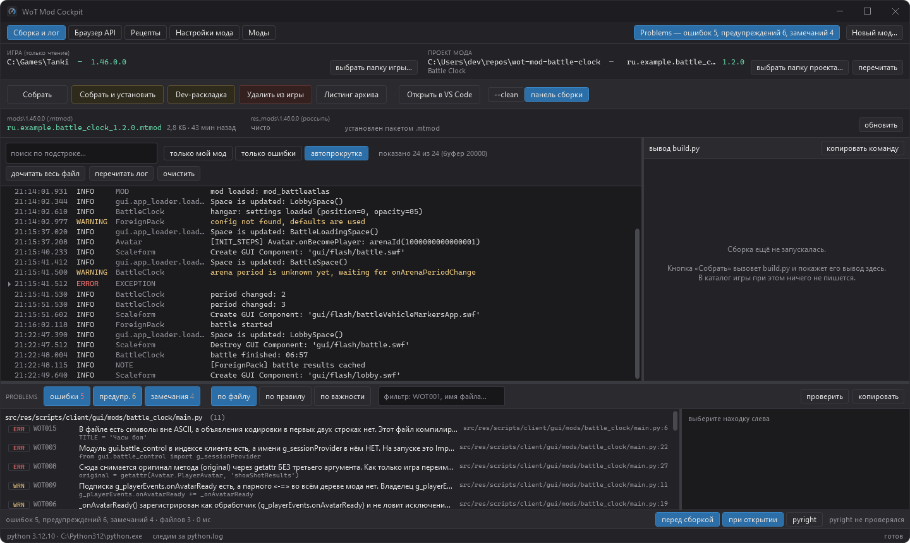
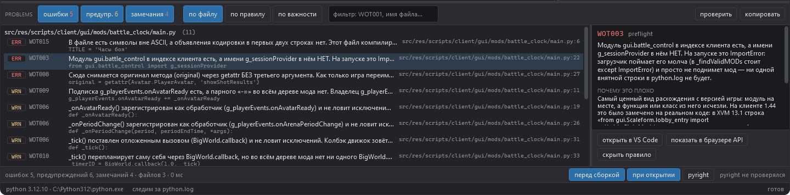
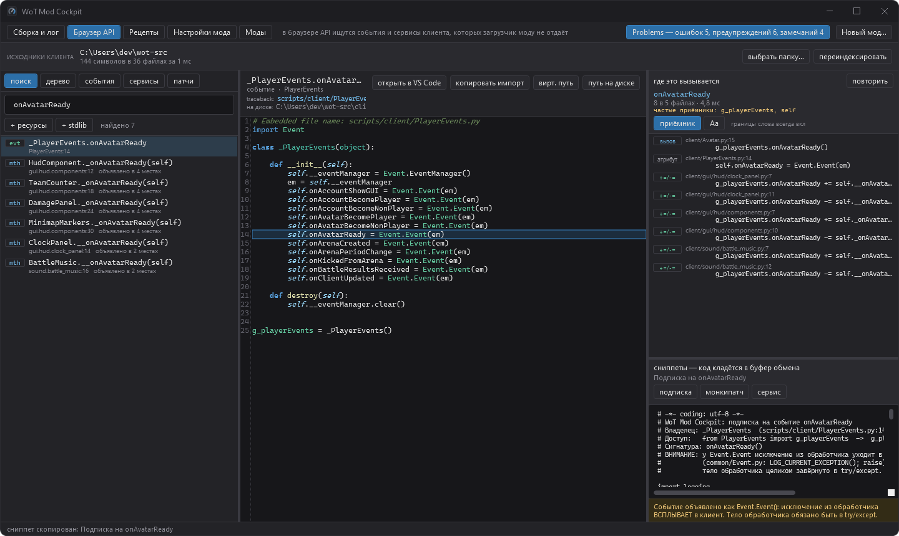
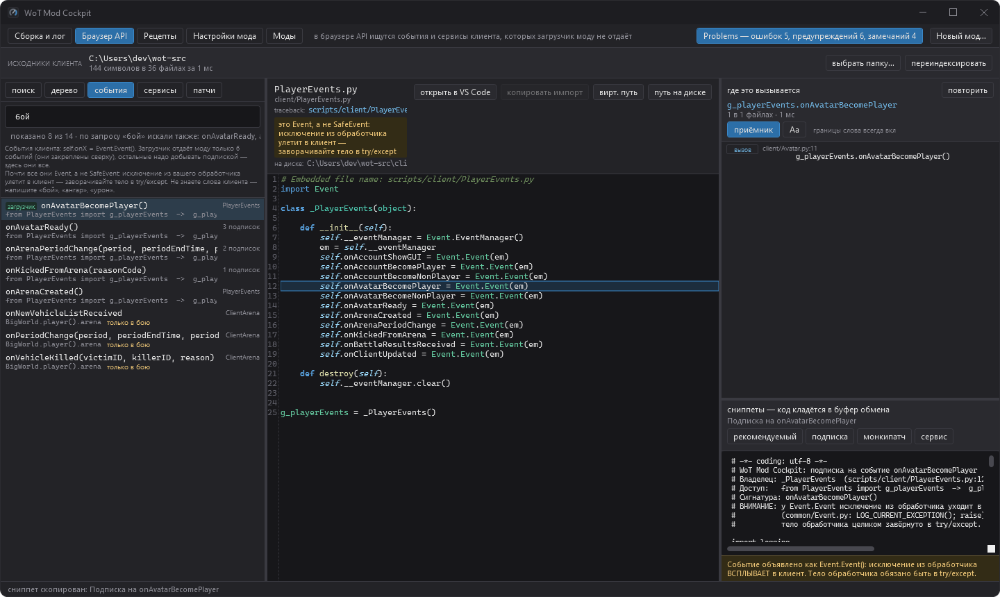
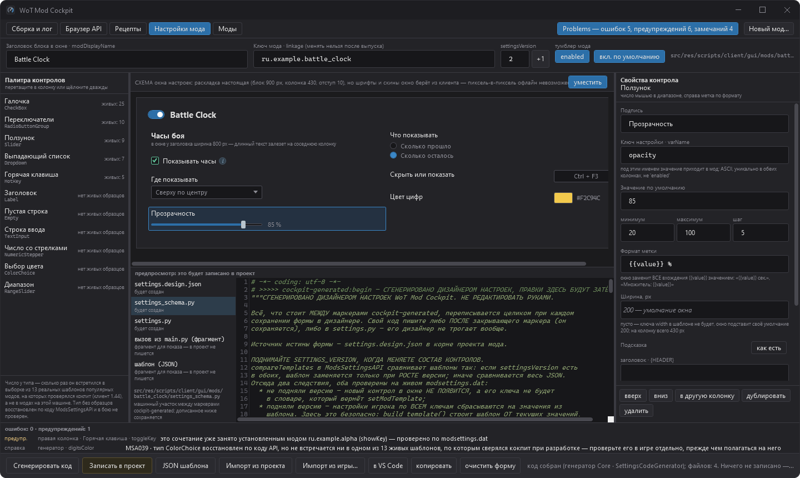
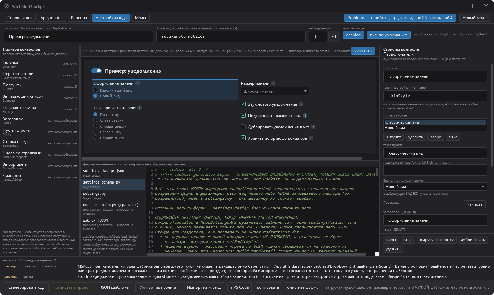
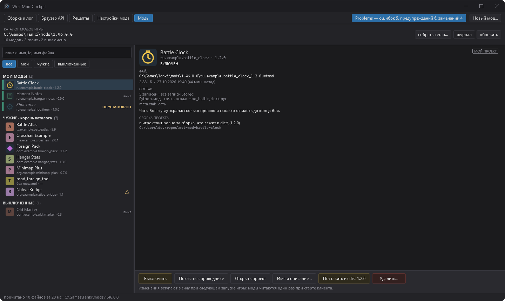
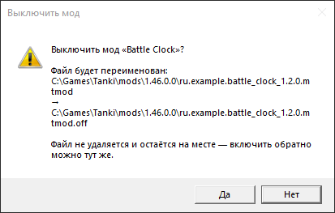
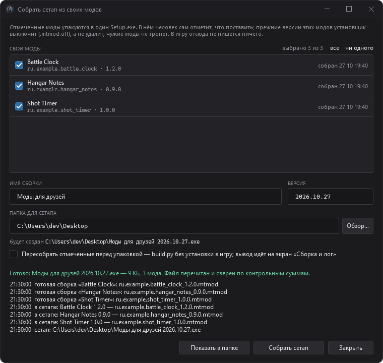
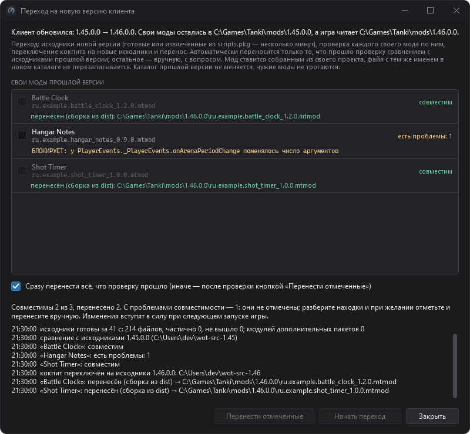

# WoT Mod Cockpit


**Настольный помощник для разработки клиентских модов «Мира танков» (Lesta) под Windows.**
Код мода пишется в VS Code, а кокпит берёт на себя всё вокруг: собирает мод и ставит его в
игру, показывает живой `python.log` и ведёт из traceback прямо на строку файла, ищет по
декомпилированным исходникам вашего клиента ответ на вопрос «что перехватить, чтобы узнать
о событии X», проверяет код мода до сборки правилами, выведенными из устройства загрузчика
модов, даёт проверенные куски кода на Python 2.7, собирает окно настроек мода мышью,
управляет установленными модами, упаковывает свои моды в `Setup.exe` для друзей и помогает
пережить обновление клиента. WPF, .NET 8, интерфейс на русском.

> Неофициальный проект. Не связан с Lesta Games и Wargaming и не одобрен ими — см.
> [Отказ от ответственности](#отказ-от-ответственности).

## In English

WoT Mod Cockpit is an unofficial Windows desktop companion (WPF, .NET 8) for developing
client-side Python mods for Lesta's «Мир танков» (Mir Tankov, the Russian-region version of
World of Tanks). It is
not a code editor — you write code in VS Code. The cockpit builds and deploys the mod through
the mod's own `build.py`, tails `python.log` and maps tracebacks to source lines, indexes
the client sources you decompile locally from your own game copy (symbols, call sites,
events, services, commonly patched methods, ready-to-paste subscription snippets), runs 22
static checks tailored to the game's mod loader before you build, offers 16 verified
Python 2.7 recipes, generates ModsSettingsAPI settings windows from a visual designer,
manages installed `.mtmod` files, packs your own mods into a standalone `Setup.exe`, and
helps move your mods to a new client version. The UI and documentation are in Russian. The
project is not affiliated with Lesta Games or Wargaming, ships no game code or assets, and
is meant only for mods allowed by the game's rules. Licence: MIT; code the cockpit inserts
into your mods is 0BSD. Maintained as is.



## Что умеет

Пять экранов (переключатель в шапке окна), док **Problems** под лентой лога, мастер
**«Новый мод…»** и два диалога на экране «Моды».

| что | коротко | подробно |
|---|---|---|
| **Сборка и лог** | кнопки `build.py` (собрать, установить, dev-раскладка, удалить, листинг); детектор «мод лежит и в `res_mods`, и в `.mtmod`»; живой `python.log`, переживающий усечение файла игрой; фильтры «только мой мод» и «только ошибки»; кадр traceback открывается в VS Code на нужной строке | [build-and-log.md](docs/build-and-log.md) |
| **Браузер API** | поиск по символам вашего клиента, «где это вызывается», каталоги событий, сервисов и часто патчимых методов с проверкой по вашей версии клиента, готовые сниппеты подписки, монкипатча и сервиса | [api-browser.md](docs/api-browser.md) |
| **Problems (preflight)** | 22 проверки `WOT001`–`WOT022` до сборки: что закроет клиент, что оборвёт чужие моды, чего нет в вашем клиенте; по желанию — разовый прогон pyright | [preflight.md](docs/preflight.md) |
| **Рецепты** | 16 проверенных кусков кода на Python 2.7 под типовые задачи, с подстановкой паспорта открытого проекта и проверкой столкновений имён | [recipes.md](docs/recipes.md) |
| **Новый мод…** | проект из шаблона `wot-mod-template` по одному полю «имя мода»; созданный проект сразу собирается в `.mtmod` | [new-project.md](docs/new-project.md) |
| **Настройки мода** | дизайнер окна настроек ModsSettingsAPI: форма мышью → `settings_schema.py` и `settings.py` на Python 2.7; импорт чужого шаблона из игры только на чтение | [settings-designer.md](docs/settings-designer.md) |
| **Моды** | лаунчер всего, что стоит в `mods\<версия>`: свои отдельно от чужих, включение и выключение без потери файла, установка из `dist\`, удаление с двумя подтверждениями | [mods-screen.md](docs/mods-screen.md) |
| **Сетап из своих модов** | свои моды в одном `Setup.exe` с галочками; получателю не нужны ни кокпит, ни .NET 8 | [setup-bundle.md](docs/setup-bundle.md) |
| **Переход на новую версию клиента** | после обновления игры: извлечь исходники новой версии, проверить свои моды на исчезнувшие и изменившиеся API клиента и перенести то, что проверку прошло | [client-migration.md](docs/client-migration.md) |

Чего кокпит не делает: не редактирует код, не запускает игру и ничего не пишет в игру без
явного нажатия с подтверждением. Полный список — в [Ограничениях](docs/limitations.md).

### Снимки окон

Все снимки сделаны на выдуманных данных: моды `ru.example.*`, игра в `C:\Games\Tanki`,
синтетическое дерево исходников (как их пересоздать — в [Тестах](docs/testing.md)).

| | |
|---|---|
|  **Problems** — находки preflight с объяснением и действиями |  **Рецепты** — код, «где ломается» и сверка с клиентом |
|  **Браузер API** — символ, исходник, места вызова, сниппет |  **Каталог событий** — запрос «бой» по-человечески |
|  **Дизайнер настроек** — форма и сгенерированный код |  **Импорт шаблона** другого мода из игры |
|  **Моды** — свои и чужие, состав архива, сверка с `dist\` |  **Подтверждение** — оба пути целиком, по умолчанию «Нет» |
|  **Сетап из своих модов** |  **Переход на новую версию клиента** |

## Требования

| что | зачем | обязательно |
|---|---|---|
| Windows 10 или 11 | WPF-приложение | да |
| [.NET SDK](https://dotnet.microsoft.com/download) 8.0 или новее | собрать кокпит из исходников | для сборки |
| .NET Desktop Runtime 8 (`Microsoft.WindowsDesktop.App 8.0`) | запустить кокпит | да; входит в SDK 8, с SDK 9/10 ставится отдельно |
| «Мир танков» (клиент Lesta) | сборка с установкой, живой лог, экран «Моды» | для этих функций |
| Python 3.10 или новее (проверено на 3.12) — в `PATH` или через лаунчер `py` | `build.py` модов и скрипты шаблона | для сборки модов |
| шаблон [wot-mod-template](#шаблон-мода-wot-mod-template) | мастер «Новый мод…», сборочные скрипты новых модов | для новых проектов |
| Python 2.7 | компиляция точки входа, если её код не укладывается во встроенный компилятор шаблона `py27c` | нет |
| `uncompyle6` и `xdis` в Python 3 | декомпиляция клиента в [дерево исходников](docs/client-sources.md) для браузера API, проверок `WOT002`–`WOT004` и перехода на новую версию | нет |
| Node.js и pyright | необязательный линтер в панели Problems | нет |
| VS Code | переход к строке из traceback, находок и браузера API | нет, но очень желательно |

Кокпит разрабатывался на клиентах «Мира танков» 1.44–1.46. Поиск установки знает и клиент
Wargaming (World of Tanks), но работа с ним не проверялась.

## Как запустить

Быстрый старт. Склонируйте кокпит и шаблон мода **в одну папку** — тогда кокпит найдёт
шаблон сам:

```powershell
git clone https://github.com/IlyaAtyukov/wot-mod-cockpit.git
git clone https://github.com/IlyaAtyukov/wot-mod-template.git
cd wot-mod-cockpit
dotnet run --project src\WotModCockpit.App
```

```
<папка>\
├─ wot-mod-cockpit\
└─ wot-mod-template\
```

Можно собрать и запускать бинарник:

```powershell
dotnet build
.\src\WotModCockpit.App\bin\Debug\net8.0-windows\WotModCockpit.App.exe
```

Заглушка установщика сетапов (.NET Framework 4.7.2) собирается тем же `dotnet build` и
кладётся рядом с кокпитом в `setup\`.

**Первый запуск.** Пока файла настроек нет (или он не читается), кокпит ищет всё сам и
записывает только то, что реально нашёл:

- **игру** — по переменной `WOTCOCKPIT_GAME_DIR`, затем по списку установленных программ,
  затем в типовых папках на несъёмных дисках (`Games\World_of_Tanks_RU`, `Games\Tanki`,
  `Games\Мир танков` и другие). Не нашлась — шапка пишет «игра не найдена» и предлагает
  **«выбрать папку игры…»** (ту, где лежит `paths.xml`);
- **шаблон мода** — соседний каталог `wot-mod-template` (см. ниже);
- **дерево исходников клиента** — `<шаблон>\.scratch\wot-src`, если оно там есть
  (см. [Исходники клиента](docs/client-sources.md));
- **Python** в настройки не записывается: пустое `pythonExe` значит «найти при сборке»
  (`python` из `PATH`, лаунчер `py`, реестр).

Проект мода на первом запуске не выбирается: создайте новый кнопкой **«Новый мод…»** или
откройте свой кнопкой **«выбрать папку проекта…»**.

**Настройки** лежат в `%APPDATA%\WotModCockpit\settings.json` (переменная
`WOTCOCKPIT_SETTINGS_DIR` переносит их вместе с журналом операций экрана «Моды» в другой
каталог). Формы для них нет: каталоги игры,
проекта и исходников выбираются кнопками, а остальное (`pythonExe`, `editorExe`,
`pyrightPath`, `modIdPrefix` …) правится в файле. Все поля, порядок поиска инструментов и
переменные окружения — в [Настройках](docs/configuration.md).

Префикс идентификатора новых модов по умолчанию — `ru.local` (поле `modIdPrefix`). Для
модов, которые вы будете публиковать, возьмите свой обратный домен, например
`io.github.<ник>`.

## Шаблон мода wot-mod-template

Сборка мода, проверка синтаксиса Python 2.7 и скрипт извлечения исходников клиента живут не
в кокпите, а в шаблоне мода — отдельном репозитории
**[wot-mod-template](https://github.com/IlyaAtyukov/wot-mod-template)**, который публикуется
отдельно и со своими условиями. В нём лежат `build.py` (сборка `.mtmod`, установка, dev-раскладка),
`tools/py27c.py`, `tools/check_py2_syntax.py`, `tools/extract_client_source.py` и
демонстрационный мод `hello_tanker`, из которого мастер «Новый мод…» делает ваш проект.

Кокпит ищет шаблон в таком порядке:

1. переменная окружения `WOTCOCKPIT_TEMPLATE_DIR`;
2. настройка `templateDir` в `settings.json` (туда же запоминается шаблон, выбранный в мастере);
3. соседний каталог: от папки с `WotModCockpit.App.exe` вверх (до 12 уровней) ищется
   `wot-mod-template` или любой `wot-mod-template*` (например, `wot-mod-template-main` из
   ZIP-архива GitHub).

Каталог считается шаблоном, только если в нём есть `build.py` и `src\meta.xml`.

Без шаблона не работает мастер «Новый мод…», а тесты, которым он нужен, пропускаются. Уже
созданный проект шаблона не требует: у него свой `build.py`. Браузер API, рецепты, дизайнер
настроек и экран «Моды» работают и без шаблона.

## Исходники клиента

Браузеру API, проверкам `WOT002`–`WOT004`, сверке рецептов и переходу на новую версию
клиента нужно дерево декомпилированных исходников **вашего** клиента. В репозитории его нет:
дерево извлекается на вашей машине из вашей установки игры скриптом шаблона или самим
кокпитом при переходе на новую версию. Как получить дерево и куда его положить — в
[Исходниках клиента](docs/client-sources.md). Без дерева остальные функции работают.

## Документация

- [Сборка и лог](docs/build-and-log.md) — проект, `build.py`, деплой, живой лог, traceback
- [Браузер API](docs/api-browser.md) — поиск, места вызова, каталоги, сниппеты, устройство индекса
- [Исходники клиента](docs/client-sources.md) — какое дерево нужно и как его получить
- [Preflight](docs/preflight.md) — панель Problems, 22 правила, pyright
- [Рецепты](docs/recipes.md) — каталог из 16 рецептов и правила вставки
- [Мастер нового проекта](docs/new-project.md)
- [Дизайнер настроек ModsSettingsAPI](docs/settings-designer.md)
- [Экран «Моды»](docs/mods-screen.md) — лаунчер и его правила безопасности
- [Сетап из своих модов](docs/setup-bundle.md) — формат, установщик, ключи командной строки
- [Переход на новую версию клиента](docs/client-migration.md)
- [Настройки и переменные окружения](docs/configuration.md)
- [Ограничения](docs/limitations.md)
- [Как устроено](docs/architecture.md) — структура решения и ключевые решения
- [Тесты](docs/testing.md) — запуск, метки, переменные окружения, снимки окон

## Отказ от ответственности

- **Неофициальный инструмент.** Проект не связан с Lesta Games и Wargaming и не одобрен
  ими. «Мир танков», World of Tanks и WoT — товарные знаки их правообладателей и упоминаются
  только для указания, с какой игрой работает инструмент.
- **Код клиента не распространяется.** Репозиторий не содержит файлов, ресурсов и
  декомпилированного дерева клиента. Исходники клиента извлекаются локально, на машине
  пользователя, из его собственной копии игры; в коде и документации кокпита есть только
  имена, сигнатуры и короткие ссылки на места в клиенте. За соблюдение пользовательского
  соглашения Lesta отвечает пользователь.
- **Честная игра.** Кокпит — инструмент разработки модов, разрешённых правилами игры. Не
  используйте его для создания запрещённых модификаций, в том числе модов, которые
  показывают скрытую от игрока информацию или автоматизируют игровые действия.
  Ответственность за мод и его распространение (в том числе через собранный кокпитом
  `Setup.exe`) несёт его автор.
- Программа предоставляется «как есть», без каких-либо гарантий (см. [LICENSE](LICENSE)).

## Лицензия

- Код кокпита — **MIT** ([LICENSE](LICENSE)).
- Код, который кокпит вставляет или генерирует в ваших модах, дополнительно лицензирован по
  **0BSD** ([LICENSE-0BSD](LICENSE-0BSD)): рецепты, каркас модуля настроек, сгенерированные
  `settings_schema.py` и `settings.py`, сниппеты браузера API, правки `meta.xml`, подстановки
  мастера «Новый мод…» и заглушка установщика вместе со встроенным в неё значком, то есть
  каждый собранный `Setup.exe`. Короче:
  код, который кокпит вставил или сгенерировал, — ваш, без обязательств по атрибуции. Полный
  перечень — в
  [src/WotModCockpit.Core/Recipes/Recipes/LICENSE.md](src/WotModCockpit.Core/Recipes/Recipes/LICENSE.md).
- Сторонние библиотеки и их лицензии — в [THIRD-PARTY-NOTICES.md](THIRD-PARTY-NOTICES.md).
- Внешние инструменты — Python, uncompyle6 (GPL-3.0), xdis (GPL-2.0), Node.js, pyright
  (MIT) — в поставку не входят: пользователь ставит их сам, а кокпит запускает их отдельным
  процессом. Не встраивайте uncompyle6 и xdis в сборки кокпита.
- Лицензии кокпита не распространяются на игру «Мир танков», её скрипты и декомпилированные
  исходники клиента, на чужие моды и на отдельный репозиторий `wot-mod-template`.

## Участие

Проект поддерживается одним человеком «как есть», без гарантий сроков и поддержки. Сообщения
об ошибках и предложения приветствуются; как их оформить и что нужно от pull request — в
[CONTRIBUTING.md](CONTRIBUTING.md).
