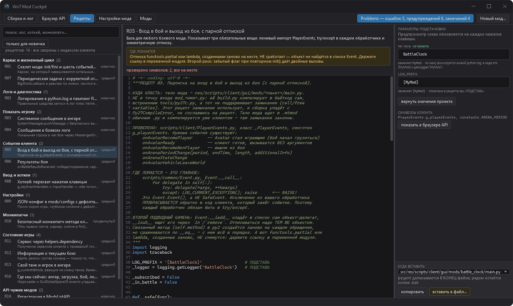

# Каталог рецептов

[← к README](../README.md)

16 готовых кусков кода на Python 2.7 под типовые задачи мода — экран «Рецепты». Каждый
рецепт сверен с исходниками клиента и состоит из трёх обязательных частей: **зачем**, **где
ломается** и собственно код.

| | рецепт | уровень |
|---|---|---|
| `R01` | скелет мода: `init`/`fini` и шесть событий загрузчика | новичок |
| `R02` | логирование в `python.log` и пампинг `flushPythonLog` | новичок |
| `R03` | системное сообщение в ангаре | новичок |
| `R04` | сообщение в боевом логе | новичок |
| `R05` | вход в бой и выход из боя, с парной отпиской | средний |
| `R06` | результаты боя | средний |
| `R07` | периодическая задача с корректной отменой | средний |
| `R08` | хоткей: перехват нажатия клавиши | средний |
| `R09` | JSON-конфиг в `mods/configs` с дефолтами | средний |
| `R10` | безопасный монкипатч метода клиента | продвинутый |
| `R11` | сервис через `helpers.dependency` | средний |
| `R12` | информация о текущем бою | средний |
| `R13` | свой танк и игрок в ангаре | средний |
| `R14` | регистрация в ModsListAPI | новичок |
| `R15` | настройки через ModsSettingsAPI | продвинутый |
| `R16` | где мы сейчас: ангар, загрузка, бой, логин | средний |

Код рецептов лицензирован по 0BSD: вставленный в ваш мод, он ваш, без обязательств по
атрибуции (см. [README](../README.md#лицензия)).

## Куда класть код

У каждого рецепта первым абзацем написано: код идёт в тело мода
`res/scripts/client/gui/mods/<пакет>/main.py`, а **не** в точку входа `mod_<имя>.py`. Точку
входа `build.py` компилирует встроенным `tools/py27c.py`, а тот понимает только подмножество
Python 2.7 и, в частности, не поддерживает замыкания. Часть рецептов их использует, и сборка
упала бы с `Py27CompileError`, которая на рецепт никак не сошлётся. Диалог вставки
предупреждает об этом отдельно, когда выбран `mod_*.py`.

## Живая параметризация

Рецепты написаны с токенами `ru.local.my_mod`, `my_mod`, `My Mod` и `MyMod`. Значения
подставляются из паспорта **открытого проекта**, поэтому вставленный код сразу пишет в лог
под тем тегом, по которому фильтрует лента «Сборка и лог». Предпросмотр перерисовывается на
каждое нажатие клавиши.

## Вставка не портит файл молча

Перед дописыванием показываются и файл, и текст. Рецепт дописывается в конец файла, рядом
кладётся копия `.bak`. Если в коде есть кириллица, а у файла нет строки `coding`, об этом
предупреждают отдельно (то же правило `WOT015`).

Отдельно проверяются **столкновения имён верхнего уровня**. Имена у рецептов пересекаются
намеренно: `subscribe`/`unsubscribe` — в `R05`, `R06`, `R13` и `R16`, `register` — в `R08`,
`R14` и `R15`, `_safe` — в `R01` и `R05`. Модуль исполняется сверху вниз, поэтому второе
объявление молча съедает первое: `R05` и `R06`, дописанные в один `main.py`, дают файл, где
подписки `R05` не выполняются никогда, а `check_py2_syntax.py` отвечает `[OK]`.

Сталкиваются не только рецепты друг с другом, но и рецепт с телом мода из шаблона: `R01`,
например, объявляет те же `init` и `fini`. Такие имена перечисляются в диалоге **до** записи,
а найденное постфактум ловит правило `WOT022`. Перекрытый колбэк загрузчика при этом —
ошибка, а не предупреждение.

## Совместимость сверяется с индексом клиента

Каждый рецепт перечисляет символы клиента, на которые опирается (всего 30 ссылок на 24
различных символа). Если дерево исходников указано (см.
[Исходники клиента](client-sources.md)), панель показывает «проверено символов: N, все на
месте» или называет пропавшие. «Не проверяли» и «нет в клиенте» — разные пометки, и путать
их нельзя.

Нативные модули движка (`BigWorld`, `ResMgr`) и API чужих модов (`R14`, `R15`) в индексе
клиента отсутствуют по определению и помечены как непроверяемые. У пяти рецептов (`R01`,
`R07`, `R09`, `R14`, `R15`) проверяемых символов нет вовсе, и панель пишет об этом
отдельной строкой, а не «проверено символов: 0, все на месте».

## Как рецепты хранятся и проверяются

Каждый рецепт — отдельный `.py` во встроенных ресурсах
(`src/WotModCockpit.Core/Recipes/Recipes/`), а не строка в C#: его можно прогнать через
проверку синтаксиса, подсветить и править без экранирования кавычек. Тесты гоняют
`tools/check_py2_syntax.py` шаблона по всем 16 рецептам трижды: на исходном коде, после
подстановки паспорта и на экзотическом имени пакета. Невалидный рецепт в каталог не
попадёт. Без шаблона эти тесты пропускаются (см. [Тесты](testing.md)).
